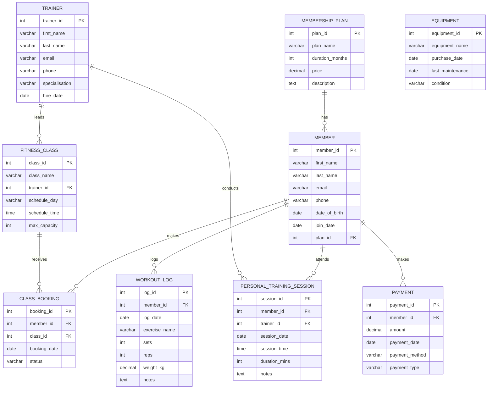

# Step 6: Entity Relationship Diagram (ERD)
# Gym Membership & Fitness Tracking System

**Student:** MiracleIsa_301905801
**Module:** MIT 8103 Advanced Database Systems

---

## ER Diagram

The diagram below shows all entities in the Gym Membership &
Fitness Tracking System and how they relate to each other.
It was created using Mermaid diagram syntax.

---

## Explanation of Relationships

- **MEMBERSHIP_PLAN to MEMBER:** One membership plan can be assigned
  to many members but each member has only one plan at a time.

- **MEMBER to CLASS_BOOKING:** One member can make many class bookings
  over time across different fitness classes.

- **FITNESS_CLASS to CLASS_BOOKING:** One fitness class can receive
  many bookings from different members.

- **TRAINER to FITNESS_CLASS:** One trainer can lead many fitness
  classes but each class is led by one trainer.

- **MEMBER to PERSONAL_TRAINING_SESSION:** One member can attend
  many personal training sessions over time.

- **TRAINER to PERSONAL_TRAINING_SESSION:** One trainer can conduct
  many personal training sessions with different members.

- **MEMBER to WORKOUT_LOG:** One member can log many workouts
  over time to track their fitness progress.

- **MEMBER to PAYMENT:** One member can make many payments for
  membership renewals and personal training sessions.

---

## Diagram Key

- **PK** = Primary Key (unique identifier for each record)
- **FK** = Foreign Key (links to another table)
- **||--o{** = One to Many relationship
- **}o--o{** = Many to Many relationship

---

*File: MiracleIsa_301905801_P1_ERDiagram.md*
*Saved in: portfolio1/ folder*